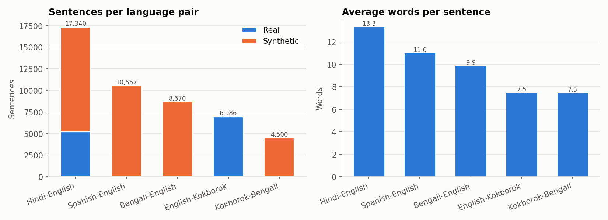
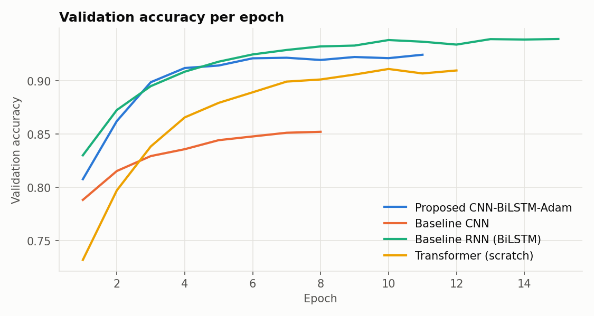
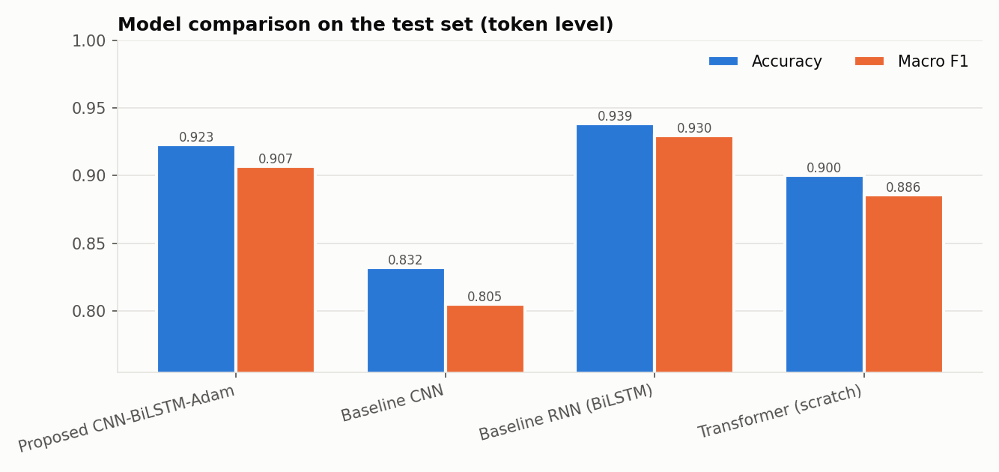
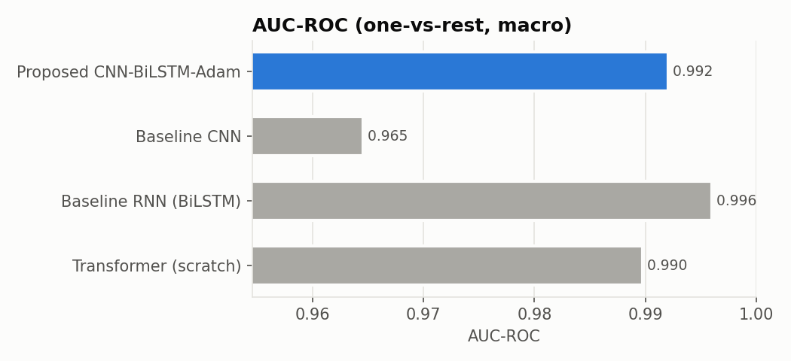
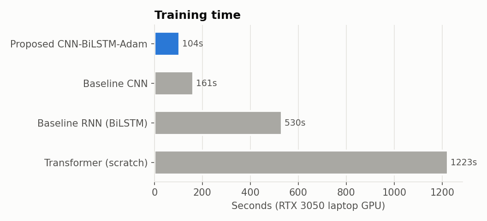
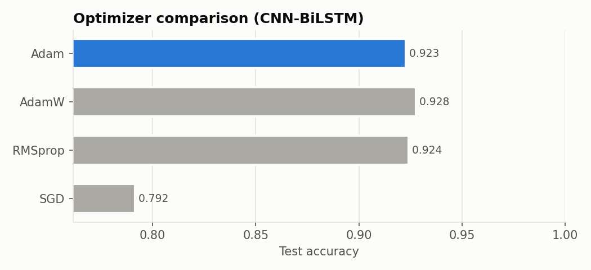
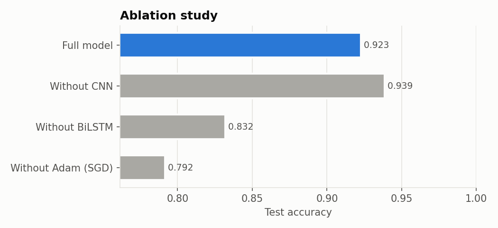
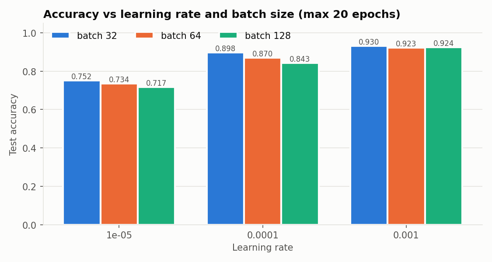
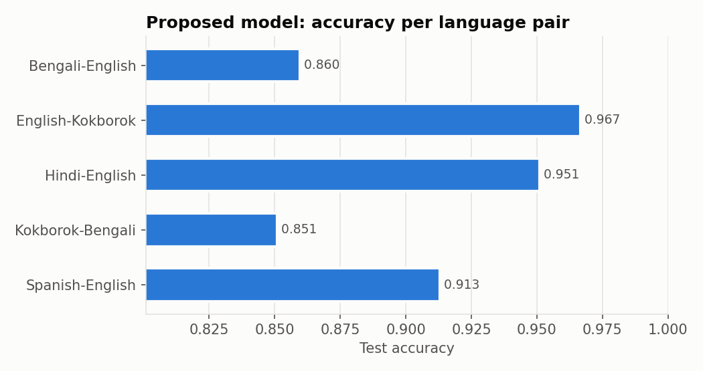
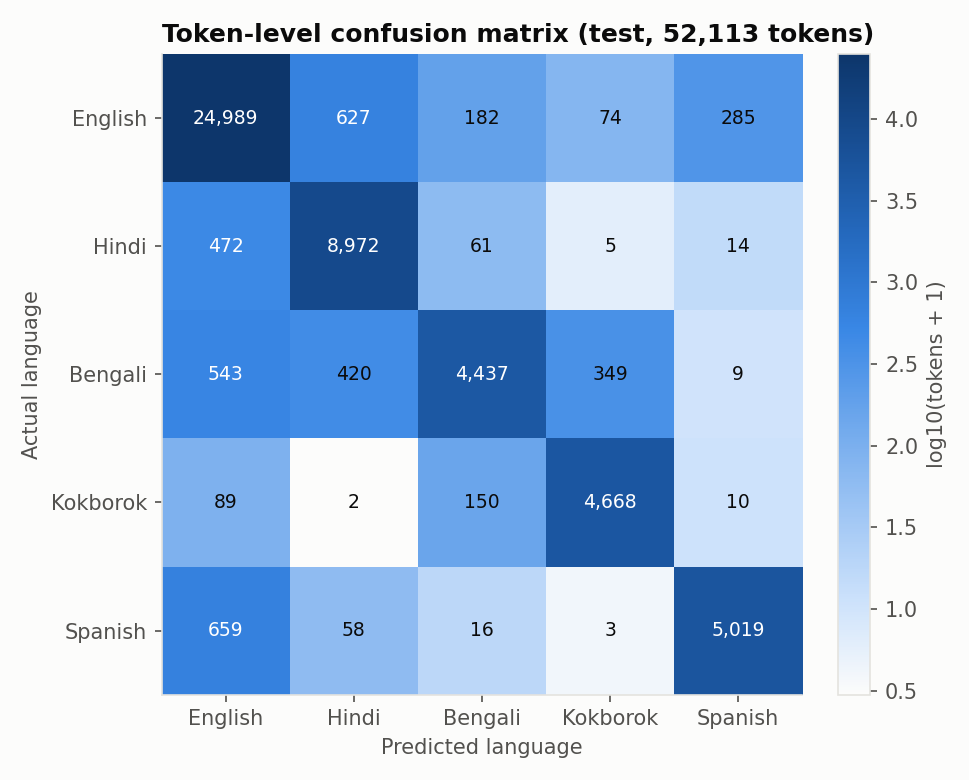

# Results report: CNN-BiLSTM-Adam for token-level code-mixed language identification

All numbers below come from real training runs in this repository (`results/runs/*.json`) and were
written into this report by `src/make_report.py`. Nothing was tuned toward the numbers in the paper.

## 1. Summary

- **Proposed CNN-BiLSTM-Adam:** **92.2% ± 1.1** token-level test accuracy
  over 5 random seeds (weighted F1 0.921, precision 0.923, recall 0.922,
  AUC-ROC 0.992). The paper reports 92.6% accuracy, F1 0.925, precision 0.926 and recall 0.924, so our
  reproduction is within about 0.4 points of the headline number.
- **Best model in our runs:** `baseline_bilstm` at 93.9%.
- **The BiLSTM-only model beat the CNN-BiLSTM**, so the CNN layer did not help on this data (see section 5).
- **Adam vs SGD:** Adam (92.3%) beats SGD (79.2%) by a wide
  margin at the same learning rate. Adam, AdamW (92.8%) and RMSprop
  (92.4%) end up close together.
- **Language pairs:** easiest is English-Kokborok (96.7%); hardest is Kokborok-Bengali (85.1%).

## 2. Data

The authors' annotated corpus is not public, so the dataset was rebuilt from the sources listed in the paper's Table 1.
**Synthetic parts are stated as synthetic, and must be described that way in the paper.**

| Language pair | Sentences | Real | Synthetic | Avg. words | Mixing ratio | Paper (sentences) |
| --- | --- | --- | --- | --- | --- | --- |
| Hindi-English | 17,340 | 5,232 | 12,108 | 13.33 | 0.334 | 17,340 |
| Spanish-English | 10,557 | 0 | 10,557 | 11.0 | 0.396 | 10,557 |
| Bengali-English | 8,670 | 0 | 8,670 | 9.87 | 0.42 | 8,670 |
| English-Kokborok | 6,986 | 6,986 | 0 | 7.48 | 0.32 | 7,330 |
| Kokborok-Bengali | 4,500 | 0 | 4,500 | 7.46 | 0.326 | 4,500 |
| **Total** | **48,053** |  |  |  |  | **48,397** |

- **Real data:**
  - LinCE Hindi-English (gold token labels, social media).
  - The authors' English-Kokborok corpus (`Code mixing and Code switching NEW DATASET 2023.docx`, 6,986 unique
    sentences).
- **English-Kokborok labels are silver labels**, made automatically by dictionary lookup against the
  English-Kokborok-Bengali Dictionary (Binoy Debbarma; 11k English headwords and 12.5k Kokborok words), with
  context rules for words found in both lists. They have not been checked by a native speaker.
- **Synthetic data:** sentences from FLORES-200 and MCS-350 (single-language) were mixed by inserting 1–3-word spans
  of one language into a sentence of the other, at the paper's code-mixing ratios. Kokborok-Bengali sentences were
  made by replacing the English spans of real Kokborok sentences with romanized Bengali spans.
- Hindi and Bengali were **romanized** (Latin script, as on social media); native scripts would make the task trivial.
- **No leakage:** every source sentence was assigned to train/val/test (80/10/10) *before* mixing, so no source
  sentence appears in more than one split.

| Split | Sentences |
| --- | --- |
| train | 38,442 |
| val | 4,806 |
| test | 4,805 |

Test set: 52,262 tokens.



## 3. Method

Same as the paper's Table 5: embedding 300 (trainable) → Conv1D 128 filters, kernel 3, ReLU → max-pooling →
BiLSTM 128 → dropout 0.5 → softmax over 5 languages per token. Training: Adam (lr 0.001, β1 0.9, β2 0.999, ε 1e-8),
batch 64, up to 50 epochs, early stopping on validation loss (patience 5), cross-entropy loss.

Deviations from the paper, and why:
1. **Max-pooling uses stride 1** (kernel 3, padding 1). The paper's pooling over the whole sequence would leave one
   vector per sentence, which makes per-token labels impossible.
2. **PyTorch instead of Keras.** TensorFlow wasn't installed; the architecture is the same.
3. **GPU:** NVIDIA RTX 3050 Laptop (6 GB). Training times are not comparable to the paper's hardware.
4. **SGD in the optimizer comparison uses momentum 0.9.** As in the paper, every optimizer uses the same learning
   rate (0.001).

## 4. Main result and stability across seeds (paper Table 10)

| Seed | Accuracy | F1 (w) | Precision (w) | Recall (w) | Macro F1 | MCC | AUC-ROC |
| --- | --- | --- | --- | --- | --- | --- | --- |
| 42 | 0.923 | 0.922 | 0.923 | 0.923 | 0.907 | 0.886 | 0.992 |
| 123 | 0.913 | 0.912 | 0.915 | 0.913 | 0.897 | 0.871 | 0.992 |
| 256 | 0.935 | 0.935 | 0.935 | 0.935 | 0.925 | 0.905 | 0.994 |
| 512 | 0.908 | 0.907 | 0.908 | 0.908 | 0.889 | 0.864 | 0.990 |
| 1024 | 0.930 | 0.931 | 0.933 | 0.930 | 0.921 | 0.900 | 0.992 |
| **Mean ± SD** | **0.922 ± 0.011** | **0.921 ± 0.012** | **0.923 ± 0.011** | **0.922 ± 0.011** | **0.908 ± 0.015** | **0.885 ± 0.018** | **0.992 ± 0.002** |

Across 5 seeds the accuracy spread is ±1.1 points. The paper reports ±0.2, which is tighter
than what we observed.



## 5. Comparison with baselines (paper Table 6, Fig. 11)

| Method | Accuracy | F1 (w) | Precision (w) | Recall (w) | Macro F1 | AUC-ROC | Train time (s) | Params | Paper acc. |
| --- | --- | --- | --- | --- | --- | --- | --- | --- | --- |
| Proposed CNN-BiLSTM-Adam | 0.923 | 0.922 | 0.923 | 0.923 | 0.907 | 0.992 | 104 | 12.8M | 0.926 |
| Baseline CNN | 0.832 | 0.829 | 0.834 | 0.832 | 0.805 | 0.965 | 161 | 12.5M | 0.870 |
| Baseline RNN (BiLSTM) | 0.939 | 0.938 | 0.939 | 0.939 | 0.930 | 0.996 | 530 | 12.8M | 0.860 |
| Transformer (from scratch) | 0.900 | 0.901 | 0.904 | 0.900 | 0.886 | 0.990 | 1223 | 14.1M | 0.900 |





**Explanation.**
- The **CNN alone** sees only a 3-word window, so it cannot use wider sentence context to decide language
  at switch points. It is the weakest model (83.2%).
- **BiLSTM-based models** see the whole sentence in both directions and do much better.
- **The BiLSTM without a CNN front-end scored 93.9%**, which is
  higher than the CNN-BiLSTM's 92.2% mean. The likely reason is that
  the convolution plus max-pooling mixes each word's features with its neighbours'. That blurs the signal exactly at
  language-switch points, where neighbouring words belong to different languages.
- **This contradicts the paper's ablation** ("Without CNN: 0.880") and should be reported honestly.
- The **Transformer trained from scratch** (90.0%) has no pretraining and only
  about 38k sentences, so it underperforms the recurrent models.
- **Pretrained mBERT / XLM-R (paper Fig. 11): not run.** Fine-tuning them on the laptop GPU needed
  4–6 hours because of thermal throttling, which didn't fit the submission deadline. So this report gives
  **no test-set numbers for them**, and the paper's claim that the proposed model beats BERT, mBERT and XLM-R is
  **not verified here**.
- *Preliminary observation (not a final result):* an interrupted mBERT run reached
  **96.9% validation accuracy after 1 epoch(s)**, which is above the proposed model. If this holds on
  the test set, fine-tuned multilingual transformers would **outperform** the CNN-BiLSTM. Before the paper claims
  the opposite, these runs should be completed (`python src/run_experiments.py pretrained`).

## 6. Optimizer comparison (paper Table 9)

| Optimizer | Accuracy | F1 (w) | Precision (w) | Recall (w) | Epochs run | Paper acc. |
| --- | --- | --- | --- | --- | --- | --- |
| SGD (momentum 0.9) | 0.792 | 0.789 | 0.791 | 0.792 | 50 | 0.882 |
| RMSprop | 0.924 | 0.924 | 0.925 | 0.924 | 13 | 0.901 |
| AdamW | 0.928 | 0.927 | 0.928 | 0.928 | 14 | 0.915 |
| Adam (proposed) | 0.923 | 0.922 | 0.923 | 0.923 | 11 | 0.926 |



**Explanation.** At the same learning rate of 0.001:
- **SGD** converges far more slowly. After 50 epochs it is still only at 79.2%.
- **Adaptive methods (Adam, AdamW, RMSprop)** scale each parameter's step size. This matters for the embedding
  matrix, where most rows (rare words) receive a gradient only occasionally. These are the "sparse gradients" the
  paper mentions.
- The three adaptive methods are within 0.5 points of each other. That is
  inside the seed-to-seed variation (±1.1), so **Adam is not clearly better than AdamW or
  RMSprop on this data.**

## 7. Ablation study (paper Table 11)

| Variant | Accuracy | F1 (w) | Precision (w) | Recall (w) | Δ accuracy |
| --- | --- | --- | --- | --- | --- |
| Full model (CNN + BiLSTM + Adam) | 0.923 | 0.922 | 0.923 | 0.923 | +0.000 |
| Without CNN | 0.939 | 0.938 | 0.939 | 0.939 | +0.016 |
| Without BiLSTM | 0.832 | 0.829 | 0.834 | 0.832 | -0.091 |
| Without Adam (SGD) | 0.792 | 0.789 | 0.791 | 0.792 | -0.131 |



**Explanation.**
- **Removing the BiLSTM** changes accuracy by -9.1 points.
  Sentence context is the most important architectural ingredient.
- **Replacing Adam by SGD** changes it by -13.1 points.
- **Removing the CNN** changes it by +1.6 points.

## 8. Learning rate × batch size (paper Fig. 9/10)

| Learning rate | Batch 32 | Batch 64 | Batch 128 |
| --- | --- | --- | --- |
| 1e-05 | 0.752 (20 ep) | 0.734 (20 ep) | 0.717 (20 ep) |
| 0.0001 | 0.898 (20 ep) | 0.870 (20 ep) | 0.843 (20 ep) |
| 0.001 | 0.930 (11 ep) | 0.923 (11 ep) | 0.924 (14 ep) |



Runs are capped at 20 epochs with early stopping.
- With lr 1e-5 the model is still far from converged after 20 epochs.
- Larger learning rates converge much faster.
- Best setting in the grid: `grid_lr0.001_bs32` (93.0%).

## 9. Error analysis

Per language (proposed model, seed 42):

| Language | Precision | Recall | F1 | Test tokens |
| --- | --- | --- | --- | --- |
| English | 0.934 | 0.955 | 0.945 | 26,157 |
| Hindi | 0.890 | 0.942 | 0.915 | 9,524 |
| Bengali | 0.916 | 0.771 | 0.837 | 5,758 |
| Kokborok | 0.915 | 0.949 | 0.932 | 4,919 |
| Spanish | 0.940 | 0.872 | 0.905 | 5,755 |

Per language pair:

| Language pair | Accuracy |
| --- | --- |
| Bengali-English | 0.860 |
| English-Kokborok | 0.967 |
| Hindi-English | 0.951 |
| Kokborok-Bengali | 0.851 |
| Spanish-English | 0.913 |



Confusion matrix (tokens, test set):

| Actual \ Predicted | English | Hindi | Bengali | Kokborok | Spanish |
| --- | --- | --- | --- | --- | --- |
| **English** | 24,989 | 627 | 182 | 74 | 285 |
| **Hindi** | 472 | 8,972 | 61 | 5 | 14 |
| **Bengali** | 543 | 420 | 4,437 | 349 | 9 |
| **Kokborok** | 89 | 2 | 150 | 4,668 | 10 |
| **Spanish** | 659 | 58 | 16 | 3 | 5,019 |



The most frequent error is **Spanish predicted as English** (659 tokens). The main causes:
1. **Words shared between languages:** *a, no, me, come, ta, na, ki* exist in more than one language, and in
   synthetic sentences the context is not always grammatical enough to disambiguate them.
2. **Romanization:** romanized Hindi and Bengali have overlapping spellings (*ke, ki, ar, kare*), which explains most
   Bengali↔Hindi errors.
3. **Unknown words:** 9.0% of test tokens never occur in training. The model sees them as a
   single unknown token and has to rely only on context. A character-level component would help, which is a
   natural improvement.
4. **Silver labels in the Kokborok data:** some errors there are labeling noise, not model errors.

## 10. Our results vs. the paper's claims

| Claim in the paper | Paper | This reproduction | Holds? |
| --- | --- | --- | --- |
| CNN-BiLSTM-Adam accuracy | 0.926 | 0.922 ± 0.011 | Yes (within seed noise) |
| Proposed model beats all baselines | yes | best is `baseline_bilstm` | No |
| CNN component helps (ablation) | +4.6 pts | -1.6 pts | No |
| BiLSTM component helps | +5.6 pts | +9.1 pts | Yes |
| Adam beats SGD | +4.4 pts | +13.1 pts | Yes |
| Adam beats AdamW / RMSprop | +1.1 / +2.5 pts | -0.5 / -0.1 pts | No (within seed noise) |
| Seed standard deviation | 0.002 | 0.011 | No (larger spread) |
| Proposed beats BERT / mBERT / XLM-R | 0.926 vs 0.90–0.91 | not run | Not verified |

## 11. Limitations

1. 75% of the dataset is
   synthetic. Synthetic mixing does not follow real code-switching grammar.
2. English-Kokborok labels are silver (automatic) and need native-speaker checking.
3. No real Kokborok-Bengali code-mixed text was available.
4. Max-pooling with stride 1 is our interpretation of the paper's architecture.
5. Training times depend on hardware. One laptop GPU was used, with cooling pauses that are excluded from the
   reported times.
6. Pretrained transformer baselines (mBERT, XLM-R) were not completed because of time and hardware limits.

## 12. How to reproduce

```
python src/prepare_data.py      # builds data/processed/
python src/run_experiments.py   # all runs -> results/runs/*.json (resumable)
python src/make_figures.py      # results/figures/*.png
python src/make_report.py       # this report
```
